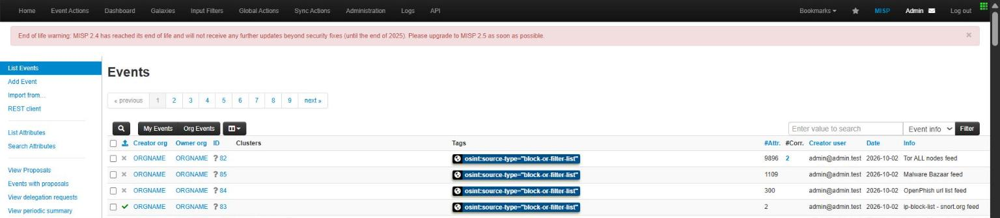
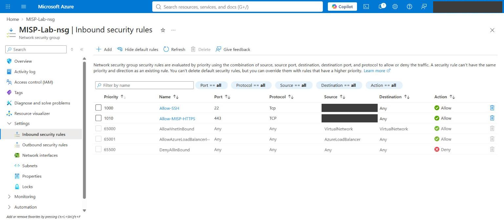

# misp-on-azure

A self-hosted [MISP](https://www.misp-project.org/) threat intelligence platform on a single Azure VM, plus a small Python toolkit (`mispkit`) for the parts of running it that annoyed me.

I first built this by hand: Ubuntu VM on Azure, network security group locked to my IP, MISP installed with the official script, six OSINT feeds turned on, and a custom phishing event created from scratch. It worked, but along the way I hit a few problems that the MISP UI doesn't warn you about. This repo is that build written down so it can be repeated, along with tools that catch those problems.



## What's in here

```
deploy/
  deploy.sh        one-command Azure deployment (VM, NSG locked to your IP, auto-shutdown)
  cloud-init.yaml  first-boot hardening + pinned MISP 2.5 installer
  allow-my-ip.sh   update the NSG rules when your home IP changes
  teardown.sh      stop / start / destroy
mispkit/           Python toolkit: IOC linting, event import, feed health checks
examples/          sample incident file and feed expectations
docs/              build notes, hardening checklist, screenshots
tests/             pytest suite (50 tests)
```

## Things I ran into

**A feed can "succeed" and give you nothing.** The snort.org IP block list finished with "Job done." and imported exactly 2 attributes: a filename and a URL. The source no longer serves a plain IP list, but MISP doesn't flag that. Tor gave me 9,896 IPs, MalwareBazaar 1,109 MD5s, OpenPhish 300 URLs, and snort 2. If you don't check the counts, a broken feed looks the same as a working one.

**One worker, six feeds.** On MISP 2.4 the default install had a single `default` worker. The CIRCL OSINT feed (1,681 events) took that worker and every other fetch job waited behind it. I started four more workers by hand. The MISP 2.5 installer used here configures five through supervisor.

**The empty-file MD5.** For the custom event I used `d41d8cd98f00b204e9800998ecf8427e` as a placeholder hash. That's the MD5 of a zero-byte file, so MISP immediately showed "Too many correlations". It's an easy mistake to make, and it's the kind of thing that pollutes a shared instance.

**Region and size restrictions.** The subscription only allowed five regions, and only one of them had a 2 vCPU / 8 GB size with available quota. `deploy.sh` now checks the SKU before creating anything, so you don't find out three minutes into a deployment.

**MISP 2.4 is end of life.** The UI shows a banner saying so. This repo deploys 2.5 on Ubuntu 24.04.

More detail is in [docs/build-notes.md](docs/build-notes.md).

## Deploy

You need the Azure CLI (`az login` first) and an SSH key.

```bash
bash deploy/deploy.sh
# or pick region/size/name
LOCATION=canadacentral DNS_LABEL=my-misp-01 bash deploy/deploy.sh
```

The script:

- refuses to run if the VM size isn't available to your subscription in that region
- creates the VM with **no** inbound rules, then opens 22 and 443 to your current public IP only
- uses SSH keys only (no passwords), with ufw and fail2ban on the host as a second layer
- installs MISP 2.5 from a **pinned commit** of the official installer, since it runs as root
- writes the installer output to a root-only log, because the installer prints the admin password and would otherwise leave it in `cloud-init-output.log`
- sets a nightly auto-shutdown so a forgotten VM doesn't drain your credit

When you're done for the day, run `bash deploy/teardown.sh stop`. The VM is deallocated, so compute billing stops and the disk is kept.



## mispkit

```bash
pip install -e .
```

### Lint an incident before it goes into MISP

```bash
mispkit lint examples/phishing-campaign.json
```

```
[WARNING] 203.0.113.25: documentation range (RFC 5737/3849) - test data, not real intel
[INFO   ] secure-login-example[.]test: was defanged, will be stored as secure-login-example.test
[WARNING] secure-login-example[.]test: reserved TLD .test - test data
...
8 indicators, 0 errors, 5 warnings
```

What it checks:

- empty-file hashes (MD5, SHA-1, SHA-256), which are an error
- a declared type that doesn't match the value, e.g. a domain filed as `ip-dst`
- hash length
- private, loopback and documentation IP ranges
- reserved TLDs (`.test`, `.example`, `.invalid`, ...)
- defanged values (`hxxps://evil[.]com`), which are refanged before import
- duplicates, compared after refanging

### Push it as an event

```bash
export MISP_URL=https://your-misp.example.com
export MISP_KEY=...            # read from the environment, never printed
export MISP_VERIFY=false       # only for a self-signed lab cert
mispkit push examples/phishing-campaign.json --dry-run   # show the payload
mispkit push examples/phishing-campaign.json
```

`push` refuses to send anything if lint finds errors, unless you add `--force`. Events are always created unpublished.

### Check a feed before you enable it

```bash
mispkit feed-check --url https://www.dan.me.uk/torlist/ --expect ip-dst --min 1000
mispkit feed-check --file snort.txt --name "ip-block-list - snort.org" --expect ip-dst --min 100
```

```
BROKEN   ip-block-list - snort.org: 2 values (filename=1, url=1)
         - only 2 indicators, expected at least 100
         - none of the values are ip - the source format has probably changed
```

Exit codes are `0` OK, `1` degraded and `2` broken, so it can run from cron or CI.

### Audit what your enabled feeds actually imported

```bash
mispkit audit --rules examples/feed-rules.json
```

This goes through each enabled feed that writes to a fixed event, pulls that event's attributes and compares them against the expected type and minimum count.

## Tests

```bash
pip install -e ".[dev]"
pytest
```

The client tests use a fake HTTP session, so no MISP instance is needed. CI also runs `shellcheck` on the deploy scripts.

## Not covered (yet)

- A real TLS certificate. The installer generates a self-signed one. Since the instance is only reachable from one IP that's acceptable for a lab, but not for anything shared.
- Backups of the MySQL database and `/var/www/MISP/app/files`.
- Azure Bastion or a VPN in place of SSH from a single IP.

## License

MIT
