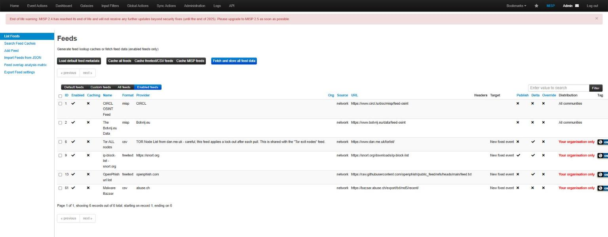
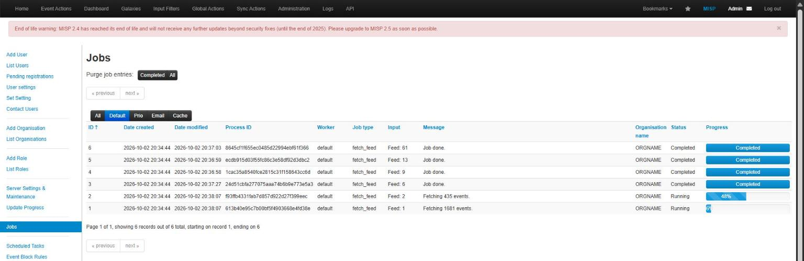
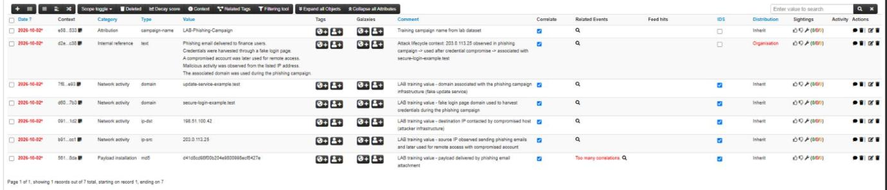

# Build notes

Notes from the first, manual build (MISP 2.4.222 on Ubuntu 22.04). The scripts in `deploy/` reproduce it on MISP 2.5 / Ubuntu 24.04.

## Infrastructure

| | |
|---|---|
| VM size | Standard_B2as_v2 (2 vCPU, 8 GiB RAM) |
| OS disk | 64 GB |
| Region | North Central US. The subscription allowed five regions, and only this one had a 2 vCPU / 8 GB x64 size with available quota |
| Access | SSH key only. NSG allows 22 and 443 from one source IP, and everything else hits the default DenyAllInBound |
| After install | `free -h` 7.7 Gi, `/` 62 G, `nproc` 2 |

On the B-series burstable size, the install takes about 20-30 minutes. Most of that is composer and the Python dependencies.

## Feeds

I loaded the default feed metadata, then enabled:

| Feed | Format | What it gives you | Imported |
|---|---|---|---|
| CIRCL OSINT | misp | full OSINT events with context | 1,681 events |
| Botvrij.eu | misp | OSINT events | 435 events |
| Tor ALL nodes (dan.me.uk) | csv | Tor relay / exit IPs | 9,896 `ip-dst` |
| MalwareBazaar recent (abuse.ch) | csv | recent malware sample MD5s | 1,109 `md5` |
| OpenPhish | freetext | phishing URLs | 300 `url` |
| snort.org ip-block-list | freetext | supposed to be IPs | **2** (1 filename, 1 url) |



### The worker bottleneck



All six fetches were queued at the same moment. With a single `default` worker, the two MISP-format feeds (CIRCL and Botvrij) ran for a long time while the small CSV feeds waited. I started four more default workers from Administration > Server Settings > Workers, and the remaining jobs went through.

The MISP 2.5 installer sets up supervisor with `numprocs=5` for the default, prio, email and cache queues. To check on a running instance:

```bash
sudo supervisorctl status | grep default
```

### Feeds that lie

The snort.org job reported "Job done." and the event it created had two attributes. The source no longer returns a plain list of IPs, so MISP parsed whatever it got. As far as MISP was concerned, nothing went wrong.

This is the reason `mispkit feed-check` and `mispkit audit` exist. For each feed you expect a type and a rough minimum count. Anything far below that gets flagged.

## Custom event

I created a phishing campaign event by hand: source IP, destination IP, two domains, an MD5, a campaign name, and a short internal note on the attack chain. All of these are documentation or test values.



Two lessons from this event:

1. **`d41d8cd98f00b204e9800998ecf8427e` is the MD5 of an empty file.** MISP flagged it with "Too many correlations". In a real incident this hash usually means an extraction step failed, not that you found malware.
2. **MISP warns when an event has no tags or galaxy clusters.** A TLP tag plus a MITRE ATT&CK technique (T1566 for phishing) makes the event much easier to filter later. The example incident file includes both.

## Hardening checklist

- [x] NSG: no inbound rules except 22/443 from a single /32
- [x] SSH keys only, root login disabled, `MaxAuthTries 3`
- [x] ufw on the host as a second layer
- [x] fail2ban for SSH
- [x] unattended security upgrades
- [x] admin password changed on first login (2.5 installer generates a random one)
- [x] installer output kept out of world-readable logs
- [x] nightly auto-shutdown and deallocate when not in use
- [ ] real certificate (Let's Encrypt needs port 80 open or DNS validation)
- [ ] database + attachments backup
- [ ] MFA (TOTP) for MISP accounts
- [ ] send MISP and auth logs to a SIEM
